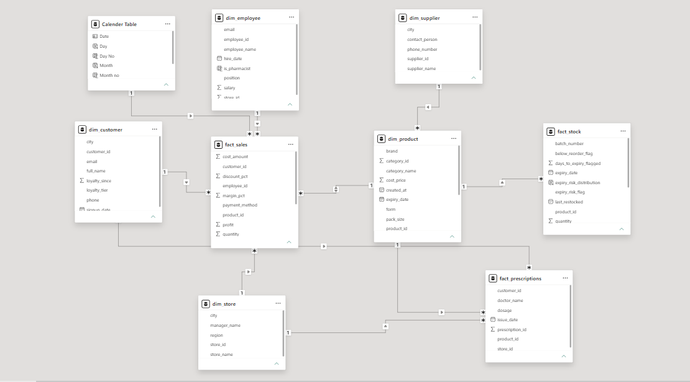
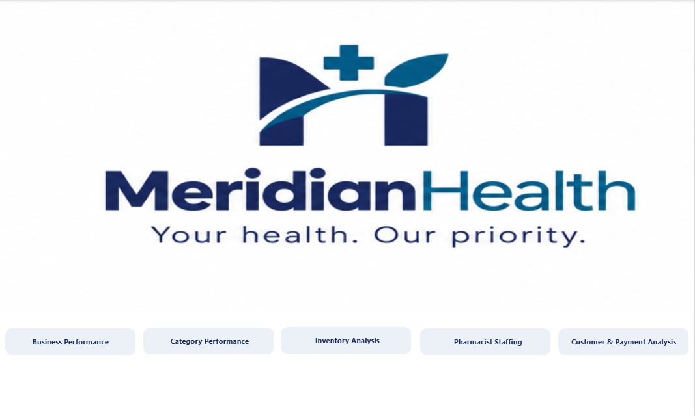
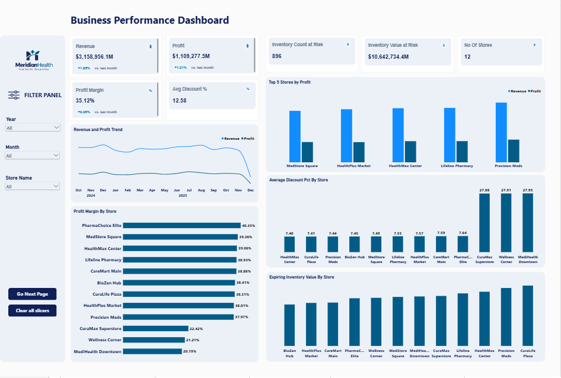
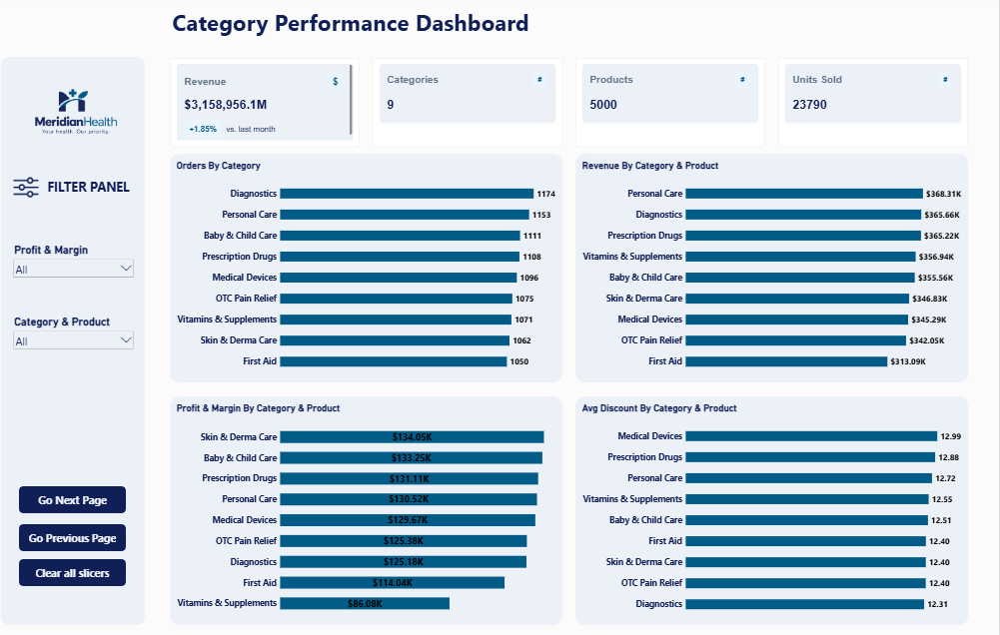
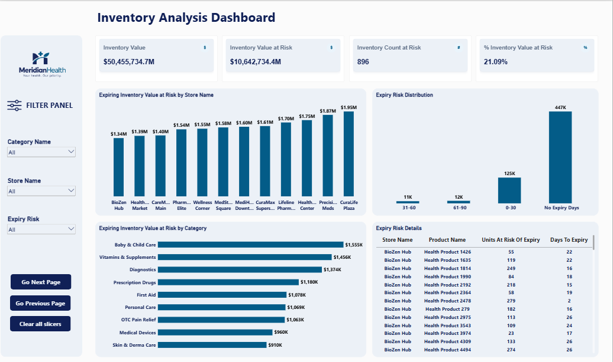
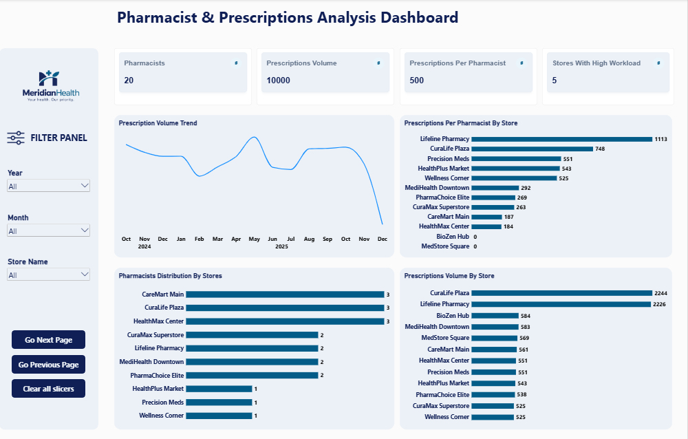
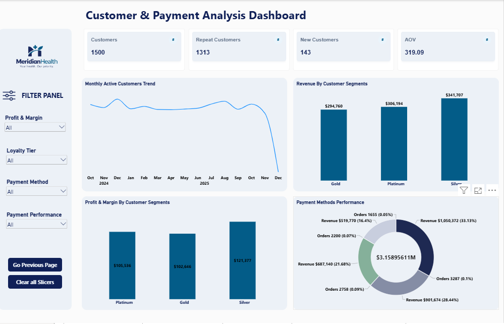

# Meridian Health Retail Group 

An end-to-end analytics project for a pharmacy retail chain: raw CSVs are cleaned and validated in Python, ingested into Databricks, and modeled and visualized in Power BI to give leadership one clear view of store profitability, inventory expiry risk, pharmacist staffing, and customer behavior.

---

## 1. Business Problem

I don't have one clear view of which locations are actually profitable, how much inventory we're at risk of writing off,
 or whether our pharmacist staffing matches demand”


---

## 2. Business Requirements (BRD)


| 1 | Which stores are genuinely profitable once real discounting is accounted for? 
| 2 | Which categories drive revenue and margin vs. just heavy discounting? 
| 3 | How much inventory is at risk of expiring unsold, and where? 
| 4 | Is pharmacist staffing matched to prescription volume? 
| 5 | Which customer segments and payment channels matter most? 

---

## 3. Project Workflow

```
Raw CSVs (9 tables)
      │
      ▼
Phase 1: Data Cleaning (Python / pandas)  ──►  /cleaned/clean_<table_name>.csv
      │
      ▼
Phase 2: Validation Script (Python)       ──►  validation_report.csv
      │        (must pass before upload)
      ▼
Databricks ingestion
      │
      ▼
Power BI data model, DAX measures & dashboards
```

---

## 4. The Data


| `fact_sales` | One row per sale (store, product, employee, customer) | ~9,900 |
| `fact_prescriptions` | Prescription records linked to customer, product, doctor | ~10,000 |
| `fact_stock` | Inventory snapshot: quantity, expiry, reorder flags | ~10,000 |
| `dim_customer` | Registered customer profiles with loyalty tier and city | ~1,500 |
| `dim_product` | Product catalogue with cost price, category, supplier | ~5,000 |
| `dim_employee` | Staff: position, pharmacist flag, store assignment | 120 |
| `dim_store` | Store locations, regions, and manager names | 12 |
| `dim_category` | Product category reference | 9 |
| `dim_supplier` | Supplier: city, contact person, phone | 5 |

A `Calender Table`  is added in Power BI.
 

### Relationships

- `dim_product` (1) → (*) `fact_sales`, `fact_stock`, `fact_prescriptions`
- `dim_store` (1) → (*) `fact_sales`, `fact_prescriptions`
- `dim_customer` (1) → (*) `fact_sales`, `fact_prescriptions`
- `dim_employee` (1) → (*) `fact_sales`
- `dim_category` (1) → (*) `dim_product`
- `dim_supplier` (1) → (*) `dim_product`
- `Calender Table` (1) → (*) `fact_sales`

`

---

## 5. Phase 1: Data Cleaning in Python

**Objective:** Load all 9 CSV files with pandas, inspect and fix each table, then export clean versions to a `/cleaned/` folder, ready for Databricks ingestion.

### Cleaning Tasks

- **Data types:** Inspect dtypes for all 9 tables; cast dates to datetime, IDs to int/str, numerics to float.
- **Null handling:** Document null counts per column and decide fill-or-drop per business logic.
- **Duplicates:** Remove exact duplicate rows; flag near-duplicates in fact tables by key column combinations.
- **Text standardisation:** Strip whitespace and apply consistent casing (Title Case for names, UPPER for codes).
- **Range validation:** Catch negative quantities, `discount_pct` > 1.0, and `margin_pct` outliers beyond ±3σ.
- **Export:** Write 9 cleaned CSVs to the `/cleaned/` sub-folder using the pattern `clean_<table_name>.csv`.

### Questions Answered in the Cleaning Notebook

1. What is the total null percentage across all 9 tables, and which table is worst?
2. Are there product IDs in `fact_sales` that do not exist in `dim_product`?
3. How many employees have a `position` / `is_pharmacist` flag mismatch (e.g. employee 97)?
4. What is the `margin_pct` distribution in `fact_sales`, and are any values suspicious?


## 6. Key Metrics (DAX)

| Total Revenue | Sales value after discount |
| Total Profit / Profit Margin % | Real store and category profitability |
| Average Discount % | Separates healthy sales from heavy discounting |
| Units at Expiry Risk | Quantity flagged by `expiry_risk_flag` |
| Value at Risk | Expiring quantity × `cost_price` |
| Prescriptions per Pharmacist | Prescription volume ÷ pharmacist headcount (`is_pharmacist = TRUE`) |
| Revenue by Loyalty Tier / Payment Method | Customer and channel mix |

---

## 7. Dashboard Pages

1. **Business Performance** – profit, margin, and discount impact by store and region
2. **Category Performance** – revenue and margin vs. discount depth by category
3. **Inventory & Expiry Risk Analysis** – at-risk stock by store, product, and supplier
4. **Pharmacist Staffing & Prescriptions** – prescription volume vs. pharmacist capacity
5. **Customer & Payments Analysis** – loyalty tiers, customer segments, payment channels








---

## 8. Key Insights

**Headline:** The company holds about **$50M** of inventory against only **$3.16M** in revenue and **$1.11M** in profit. Roughly **21% of that inventory (~$10.64M)** is at risk of expiring unsold, so the real problem is inventory exposure, not sales.

### 1. Business Performance
**Question:** Which stores are genuinely profitable once real discounting is accounted for?

- Revenue is ~$3M, inventory value is $50M, and inventory value at risk is ~$10M.
- Revenue and profit started dropping in **Nov 2025**, falling by about a quarter by Dec 2025.
- The average discount across the chain is **7.44%**.
- **Top 5 stores by profit** (margin, average discount, expiry value at risk):
  1. Precision Meds: 37.97%, 7.44%, $1,950,202
  2. Lifeline Pharmacy: 38.93%, 7.55%, $1,697,808
  3. HealthMax Center: 39.06%, 7.40%, $1,751,511
  4. Medstore Square: 39.36%, 7.49%, $1,583,813
  5. HealthPlus Market: 38.01%, 5.57%, $1,390,442
- Precision Meds earns the most profit but has the biggest expiry exposure, so high profit hides high risk. Across the top 5, expiry value at risk is very large.
- PharmaChoice Elite has the best margin of the top group (40.35%, expiry risk $1,540,197).
- Three stores (CuraMax Superstore, Wellness Corner, MediHealth Downtown) have the **highest average discounts, a much lower margin than the rest, and the lowest revenue**. Heavy discounting is not driving sales.

### 2. Category Performance
**Question:** Which categories drive revenue and margin vs. just heavy discounting?

- 9 categories, ~5,000 products, and ~23,790 units sold.
- **Personal Care** leads on revenue (profit $131K) but has the highest average discount (12.72%) and a lower margin (35.44%), with ~$1.07M in expiry value.
- **Skin & Derma Care** is among the top revenue categories with solid profit and margin.
- **Medical Devices** has a strong margin with the lowest discounting and low expiry exposure.

### 3. Inventory Analysis
**Question:** How much inventory is at risk of expiring unsold, and where?

- Inventory value is $50M, with $10.64M (**21%**) at risk across **896** at-risk inventory items.
- **Baby & Child Care** is the largest at-risk category (~$1.55M), and the top 3 stores account for ~$2.98M.
- About **125K units** expire within 0 to 30 days, so these need action first.

### 4. Pharmacist & Prescriptions Analysis
**Question:** Is pharmacist staffing matched to prescription volume?

- 20 pharmacists handle 10,000 prescriptions, an average of **500 prescriptions per pharmacist**.
- **5 stores** have a workload above the chain average, meaning prescriptions per pharmacist is higher than average.
- Staffing is unevenly spread: one store handles ~100 prescriptions with a single pharmacist while another handles ~8 with three. Some stores (for example Medstore Square) have more pharmacists than their prescription volume needs.

### 5. Customers & Payment Analysis
**Question:** Which customer segments and payment channels matter most?

- 1,500 customers: **143 new** and **1,313 repeat**, with an average order value (AOV) of **$319**.
- New customer growth fell sharply from Nov 2025, which cut prescriptions and therefore revenue and profit in that period.
- **Silver** is the most valuable customer segment by profit and margin.
- **Credit Card** leads in revenue and orders, while **Debit Card** has the highest AOV.


## 9. Tools & Skills

- **Python (pandas)** – data cleaning and validation
- **Databricks** – data ingestion and storage
- **Power BI** – data modeling, DAX, visualization


